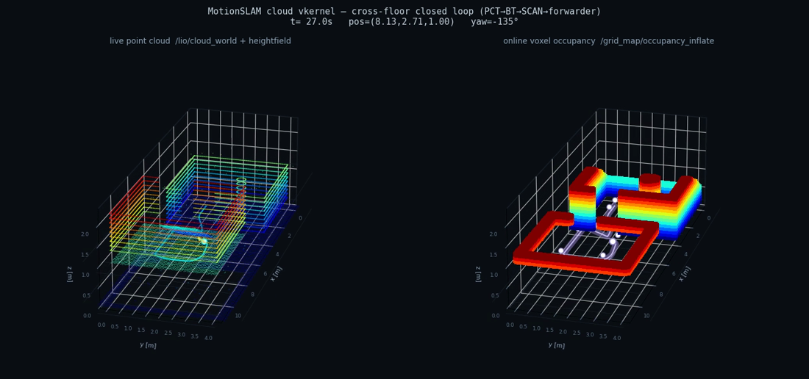

# Go2 真机链路 · Quadruped Cross-Floor Navigation

[](LICENSE)
[](https://docs.ros.org/en/humble/)

> **真机跑通的这一份代码**：Go2 + Livox Mid-360，在线建图 → PCT 全局指引 → SCAN 连续局部规划 → Forwarder → Sport API。
> ROS 2 overlay（`src/`）+ `docker/` + `scripts/` + `patches/` + `third_party/` 都在本分支；2026-11 起冻结只读，真机部署只认这里。ROS-free 的运行时主线在 [`main`](https://github.com/zxinyu-robot/autonomous-robot-task-navigation/tree/main)。

## 演示

| 云端多楼层闭环（vkernel，11 航点 11/11） | 真机在线建图 + 规划 |
|---|---|
|  |  |

- 视频：[云端闭环](docs/media/cross_floor_demo.mp4) · [真机在线 + Elevator-LIO 回放](docs/media/cross_floor_with_elevator_lio.mp4)
- 真机段是 Go2 + Livox Mid-360 在线建图与规划；后半段是 Elevator-LIO `Office9.bag` 的 Open3D 场景回放 —— **是场景重建，不是官方 LIO 结果**。真机跨楼层完整闭环（电梯段自主）**未完成**。



- [Jazzy 原生复现录像](docs/media/cross_floor_sim_jazzy_20261121.mp4)，记录见 [云端跨楼层仿真_Jazzy原生复现_20261121.md](docs/证据汇报/云端跨楼层仿真_Jazzy原生复现_20261121.md)
- 场景回放：[HM3D dollhouse](docs/media/hm3d_ep0_dollhouse.mp4) · [HM3D 点云](docs/media/hm3d_ep0_pointcloud.mp4)
- 数据状态流转时序：[state_flow_seq.png](docs/media/state_flow_seq.png)

## 跑起来

前置：Jetson Orin NX（或同架构 Linux）、Docker、Go2 与 Mid-360 同网段可达、系统时间正确（时间错误会导致 apt/gmake 失败）。

```bash
git clone https://github.com/zxinyu-robot/autonomous-robot-task-navigation.git
cd autonomous-robot-task-navigation
git checkout platform/go2

# 雷达网络（真机必需；位置由 sensors.launch.py 决定）
cp src/motionslam_bringup/config/MID360_config.example.json \
   src/motionslam_bringup/config/MID360_config.json   # 填现场雷达 / 主机 IP

# 镜像 + 容器内编译工作区（宿主机没有 ROS，必须在容器里编）
docker build -t motionslam:humble docker/
./docker/run_container.sh ./scripts/dev/build_ws.sh

# 起栈 → 看日志 → 停栈（宿主机执行，nav start 会自己拉起容器）
export GO2_IP=<机器狗 IP>          # Foxglove 绑定用
./scripts/motionslam nav start
./scripts/motionslam nav watch     # 关键事件；-f 实时跟 /demo/mission/event
./scripts/motionslam nav stop      # 急停并停栈
```

- 环境变量：`DEMO_PROFILE`（默认 `demo_short`）、`WITH_FOXGLOVE`、`WITH_PCT_PLANNER`，完整清单见 `scripts/nav/start_demo_scan_nav.sh` 顶部。
- 真机参数基线以 `src/motionslam_bringup/config/demo_scan_planner.yaml` 为准，云端 overlay 不得回灌真机。
- 接缝自检（容器内）：`./docker/run_container.sh ./scripts/dev/verify_dds.sh`
- 现场必须有急停路径与安全确认。

## 记录与文档

| 入口 | 内容 |
|---|---|
| [docs/运维/runbook.md](docs/运维/runbook.md) | 起停、故障处理、现场 runbook |
| [docs/运维/GO2_主路径三条命令.md](docs/运维/GO2_主路径三条命令.md) | 真机最短操作路径 |
| [docs/测试验收/测试记录.md](docs/测试验收/测试记录.md) | 分步验收记录（`step1/step2/step3` 原始日志在同目录） |
| [docs/证据汇报/](docs/证据汇报) | 证据包、现场采集清单、Jazzy 复现记录 |
| [docs/云端闭环_vkernel.md](docs/云端闭环_vkernel.md) | 云端多楼层闭环 |
| [docs/ROADMAP.md](docs/ROADMAP.md) | 路线与待办 |
| [docs/架构/架构_端侧系统架构.md](docs/架构/架构_端侧系统架构.md) | 目标架构（三空间、两个平面） |
| [docs/开发参考/](docs/开发参考) | DDS 性能、PCT 接入、外参标定、Foxglove 等专题 |

运行时的接口、契约与测试说明在 [`main`](https://github.com/zxinyu-robot/autonomous-robot-task-navigation/tree/main)：`runtime_core/`、`fork_spatial/`、`interfaces/motionslam_msgs/`。

## 署名与许可

主导与系统设计：zxinyu（zxiangsheng2314@gmail.com）。自研代码 [MIT](LICENSE)；`patches/`、`third_party/` 与外部依赖按各自来源授权，见 [THIRD_PARTY.md](THIRD_PARTY.md)。
