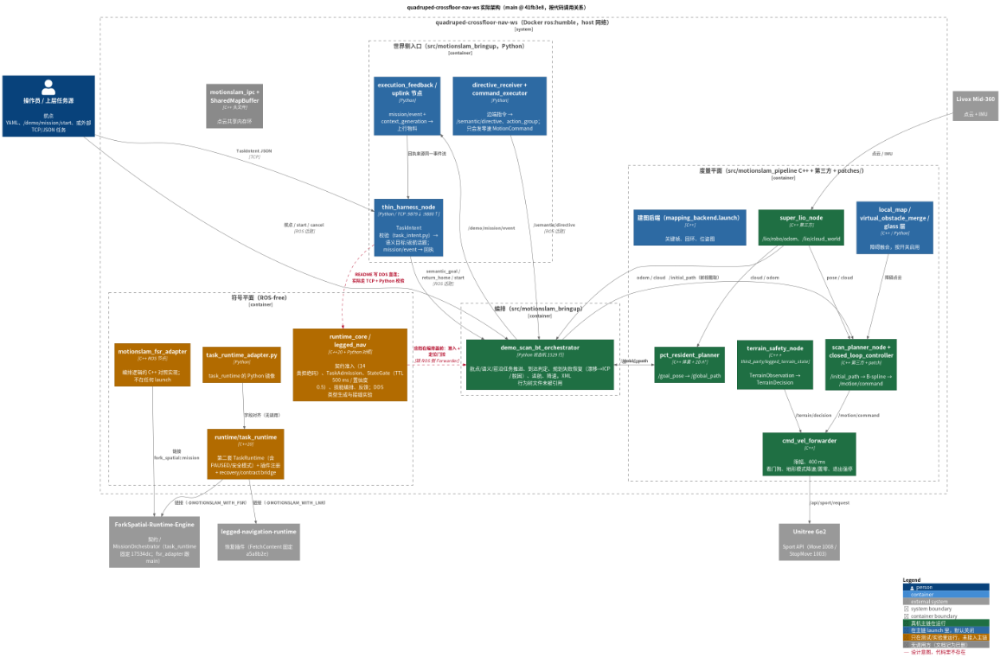

# Quadruped Cross-Floor Navigation Runtime

[](LICENSE)

> 端侧任务运行时：**让上层智能决策能够安全、可验证、可恢复地调用底层机器人运动能力**。
> 决策进来只是一张任务意图，能不能执行由状态门控裁决，结果用稳定类型回执 —— 不靠日志猜，也不允许绕过裁决直接下发运动。

## 分支说明

| 分支 | 内容 | 状态 |
|---|---|---|
| `main` | 运行时：`runtime_core/`、`runtime/task_runtime/`、`fork_spatial/`、接口消息、架构与契约文档 | 主线，按运行时管理 |
| [`platform/go2`](https://github.com/zxinyu-robot/quadruped-crossfloor-nav-ws/tree/platform/go2) | Go2 真机跑通链路：ROS 2 overlay（`src/`）、`docker/`、`scripts/`、`patches/`、`third_party/`、运维与验收记录、演示视频 | 冻结、只读；真机部署只认这个分支 |

Go2 在 `main` 上是一个被接入的平台。`main` 文档里提到的 `src/`、`scripts/`、`docker/` 路径都指 `platform/go2` 分支。首页图片统一存在 `main` 的 `docs/media/`，`platform/go2` 的 README 直接引用这里的文件，不重复存二进制。

## 项目定位

上层（模型或任务决策）只给任务意图；运行时负责契约准入、空间状态门控、技能编排、生命周期、异常恢复和执行反馈；下层通过 Robot Adapter 接各平台的运动控制。

**明确不做**：端侧大模型实时推理；从世界侧下发速度；多机协同（在关联仓）。

## 目录

| 目录 | 职责 | 语言 / 构建 |
|---|---|---|
| `runtime_core/` | 任务契约准入、StateGate、技能编排、执行反馈、DDS 类型生成与接缝实验 | C++20 + Python 对照实现，ROS-free |
| `runtime/task_runtime/` | 任务状态机与插件注册；可选 LNR 恢复桥、FSR 契约桥 | C++20，ROS-free |
| `fork_spatial/` | 空间状态契约与故障注入、Token / ESN / 端侧策略、MissionOrchestrator（原 ForkSpatial-Runtime-Engine） | C++20，ROS-free |
| `interfaces/motionslam_msgs/` | 跨平面 `.msg` 原件（含 rebind 草案）；`runtime_core/dds/` 的 DDS 类型由它导出生成 | ROS 2 interface 包 |
| `contracts/` | 契约原件索引（原件留在各模块，不搬放） | — |
| `docs/` | 架构、规划、符号空间契约、DDS 参考；`docs/架构/assets/`、`docs/media/` 存首页用的图 | — |

三个模块的职责还有重叠（两套 `TaskRuntime`、两份 `SpatialState`），对照与合并顺序见 [模块职责与交互契约](docs/架构/模块职责与交互契约.md)。

## 验证程度

| 部分 | 等级 | 依据 |
|---|---|---|
| 契约准入 / StateGate / 编排 / 反馈 | 合成数据·单元测试 | `runtime_core` ctest + pytest |
| task_runtime + LNR 恢复桥 + FSR 契约桥 | 合成数据·单元测试 | `runtime/task_runtime` ctest |
| fork_spatial 空间状态与故障注入 | 合成数据·单元测试 | `fork_spatial` ctest + demo |
| DDS 接缝互通、QoS、SHM、长稳 | 本机原生环境实验（非容器、非真机） | `runtime_core/docs/dds-interop.md` |
| 运行时接入 Go2 真机主链 | **计划中**（当前真机链路不经过运行时） | — |

## 一条完整链路：跨楼层任务从进来到反馈回去

以「从一楼去二楼会议室门口」为例走一遍真实链路。每一步都标出谁执行、门在哪、失败回哪一层。

| # | 发生什么 | 执行者 | 被拦下时 |
|---|---|---|---|
| 1 | 产出任务意图：目标点、楼层、`map_id`、`revision` | 世界空间 | 不产生意图就什么都不发生 |
| 2 | `TaskIntent` 过 DDS 接缝（只载符号量） | 接缝 | — |
| 3 | 契约校验：14 类拒绝码（schema / 平台 / 禁区 / 禁控字段 / 参数） | `runtime_core` `admission` | `REJECT_*`，不进执行 |
| 4 | 准入仲裁：task_id 幂等、重复受理、忙态、优先级抢占 | `runtime_core` `TaskAdmission` | `IDEMPOTENT` / `REJECT_DUPLICATE_TASK_ID` / `REJECT_BUSY` / `PREEMPT` |
| 5 | 状态门控：定位有效性、TTL 500 ms、置信度 ≥ 0.5、地图版本一致 | `runtime_core` `StateGate` | 进 `HOLDING`，**不拿过期定位继续走** |
| 6 | 技能编排：`Navigate` → 导航 BT 接管该技能生命周期 | `runtime_core` → BT | `failed(reason)` 上行 |
| 7 | PCT 给全局指引 + SCAN 做局部连续规划（技能内度量算子） | 度量平面 | BT 重决策，换指引而非重试同一点 |
| 8 | 速度与控制下发 | Forwarders → Sport API → Go2 | 本体现急停 |
| 9 | 逐点到达判定 → 技能结果 | BT | 稳定类型 `reached`/`stuck`/`plan_fail`/`link_lost`（见下方 ① 翻译面） |
| 10 | `ExecutionFeedback` 回执 + 带 `session`/`context_generation` 的物料归档 | 接缝 | — |

三个要点：

- **决策与执行的唯一接缝在第 2 步和第 10 步。** 中间 3–9 步没有世界侧介入，也没有从世界侧下发的速度。
- **第 5 步是安全的关键。** 定位不可信时进 `HOLDING`，而不是「继续走、边走边修」—— 这是符号空间存在的直接理由。
- **第 6 步之后不是一条直线。** 第 7 步失败回到第 6 步重决策，而不是让 BT 重试同一个目标点。

> 第 7–9 步（PCT / SCAN / Forwarders / Go2）在 [`platform/go2`](https://github.com/zxinyu-robot/quadruped-crossfloor-nav-ws/tree/platform/go2) 分支；当前真机链路还不经过第 3–5 步的运行时裁决。

## 架构：两个平面一条接缝



> 图源 `docs/media/qcn_arch.png`（生成时的代码快照）。颜色即验收级别：**绿**＝真机主链在运行、**蓝**＝主链 launch 里默认关闭、**橙**＝只在测试/实验中运行、**灰**＝云端两层（文档记录已闭环）、**红虚线**＝设计意图、代码里没有。图上带 `src/` 前缀的节点，实体在 [`platform/go2`](https://github.com/zxinyu-robot/quadruped-crossfloor-nav-ws/tree/platform/go2) 分支。

下面的文字图只保留两个平面和一条接缝，不看目录。

```text
┌─ 符号平面（runtime_core/）──────────────────────────────────────────────────────┐
│  语义观测 → TaskIntent 契约准入 → StateGate → 技能编排 → Forwarder → 执行反馈    │
│  契约单一来源 contracts/runtime_contract.json；.msg → IDL → idlc 类型确定性生成  │
└───────────────────────────────┬─────────────────────────────────────────────────┘
                                │  DDS（CycloneDDS，无桥接；同机 iceoryx SHM）
                                │  只载 TaskIntent / ExecutionFeedback / mission event
┌───────────────────────────────┴─────────────────────────────────────────────────┐
│  度量平面（导航执行栈）                                                          │
│  Super-LIO 位姿 → PCT 全局指引 → SCAN 局部规划(tomogram+B-spline) → Forwarders  │
│  → Unitree Sport API → Go2                                                      │
└─────────────────────────────────────────────────────────────────────────────────┘
```

**三空间归属**：

```text
世界空间  World     语音 / VLM / 因果地图 / 上游世界模型 / 仿真 / 多机意图
    ↕ ② 决策翻译（任务、拒绝、策略回放；禁止下发速度）
符号空间  Symbolic  技能名 / 模式 / 事件 / 观测标签 / session·代数 / Policy
    ↕ ① 行为翻译（占据→可通行/可探索/可归档；轨迹→技能结果）
度量空间  Metric    点云·位姿·tomogram·B-spline·Sport / 本体控制器
    ↕ ③ 数据交互（版本化物料或观测 ↔ 世界；不是原始路径 dump）
```

三层完成度并不相同，读的时候别混：

| 空间 | 当前到哪一级 | 依据 |
|------|--------------|------|
| 度量空间 Metric | **真机部分**：在线建图与规划已通，跨楼层完整闭环未完成 | 真机视频、Elevator-LIO 回放 |
| 符号空间 Symbolic | **单元测试级**：契约/门控/编排/反馈全链路有实现与测试（231 项 C++ 检查、91 项 pytest） | `runtime_core/docs/evidence.md` |
| 世界空间 World | **数据集回放级**：VLM 回放跑通（ARKitScenes 15/15、Elevator-LIO 25 帧），端侧真机部署计划中 | 同上 |

世界空间不是「空层」，但也还不是可部署的端侧世界模型 —— 目前只到「能读数据集、能产出意图」。

①②③ 三个翻译面的硬约束：

| 翻译面 | 硬约束 | 本仓实现位置 |
|--------|--------|--------------|
| **① 行为翻译** | 失败回程用稳定类型（`reached`/`stuck`/`plan_fail`/`link_lost`），不是日志字符串 | `runtime_core/src/feedback.cpp`、BT 到达判定 |
| **② 决策翻译** | **禁止下发速度** | `runtime_core/src/admission.cpp`、`src/motionslam_bringup`（platform/go2） |
| **③ 数据交互** | **不是原始路径 dump** | 物料上行带 `session` / `context_generation` |

**OS0**：执行只发生在度量空间。定义与编号对应见 [三空间架构](docs/架构/架构_端侧系统架构.md)。

### 两层调度，不是重复造行为树

`runtime_core` 和导航 BT 都叫「调度」，但管的东西不重叠。既然已经有行为树还要 `runtime_core`，是因为行为树管不到「这次任务该不该被受理」。

| | `runtime_core`（符号平面） | 导航 BT（度量平面） |
|---|---|---|
| 管什么 | **任务级生命周期**：准入、优先级、抢占、跨技能失败策略 | **技能级生命周期**：子目标推进、到达判定、技能内恢复 |
| 一次决策的粒度 | 一个任务（可能含多个技能） | 一个技能内的一次重试或换路 |
| 状态从哪来 | `SpatialState` 快照（位姿、置信度、地图版本） | LIO 位姿、局部代价图、规划结果 |
| 失败往上报给谁 | `ExecutionFeedback` → 世界侧 | 稳定类型 → `runtime_core` |
| 缺了它会怎样 | 定位过期时没人拦，上层能直接下发运动 | 技能内每次卡住都要回任务级，恢复太慢 |

> **BT 不是 SCAN 的前一级**：PCT / SCAN 是技能内部的度量算子，不是 BT 的下游节点。把三者画成直线，会掩盖「失败到底该回哪一层重决策」。

## 测试报告

**符号平面**（`runtime_core/`，无需 ROS）

| 项 | 结果 | 证据 |
| --- | --- | --- |
| C++ 测试 | `ctest` **2/2**（开 `-DLEGGED_NAV_BUILD_DDS=ON`；默认 OFF 时 1/1） | `runtime_core/tests/` |
| Python 测试 | `pytest` **91** 项 | `runtime_core/tests/` |
| 契约一致性 | 契约与 DDS 类型生成物 `in sync`（5 msg） | `gen_contract.py --check`、`gen_dds_types.py --check` |

**接缝**

| 项 | 结果 | 证据 |
| --- | --- | --- |
| 双向互通（原生 ↔ ROS） | **4/4 通过**，envelope / probe × 双向，字段逐项断言 | `runtime_core/scripts/dds_interop_check.py` |
| QoS 兼容性矩阵 | **7/7** 符合 DDS requested/offered | `runtime_core/scripts/dds_qos_matrix.sh` |
| SHM 实际生效 | 131 MB 载荷：SHM 关 lo 上 UDP 273.6 MB → SHM 开 **4.2 KB** | `runtime_core/scripts/dds_shm_proof.sh` |
| 长稳 64 KiB @ 10 Hz × 20 min × 4 轮 | 零丢失（11960/11960），p50 **1108–1134 µs**，p95 2026–2064 µs | `runtime_core/scripts/dds_soak_repeat.sh` |
| 接收退出语义 T4（100+1s+100）× 5 | 5/5 无提前退出，`idle=2000 ms` | `runtime_core/scripts/dds_sub_exit_cases.sh` |

**度量平面**：云端多楼层闭环 11/11、真机在线建图与规划 —— [云端闭环视频](https://github.com/zxinyu-robot/quadruped-crossfloor-nav-ws/blob/platform/go2/docs/media/cross_floor_demo.mp4)、[真机在线 + Elevator-LIO 回放视频](https://github.com/zxinyu-robot/quadruped-crossfloor-nav-ws/blob/platform/go2/docs/media/cross_floor_with_elevator_lio.mp4)；实现、运维与验收记录都在 [`platform/go2`](https://github.com/zxinyu-robot/quadruped-crossfloor-nav-ws/tree/platform/go2) 分支。

**未验证**（不写成已验证）：Humble 容器内复跑上述接缝数字、arm64 / Jetson 实机、≥2 小时长稳、writer-only / reader-only 深度拆分。

接缝的全部时序记录、踩坑与策略调整收敛在一份文档：[runtime_core/docs/dds-interop.md](runtime_core/docs/dds-interop.md)。

> 该文档记录的教训：**`dds_write` 返回成功不代表数据已交付**。曾有一批"性能数据"来自没有建立匹配关系的运行，现基准程序内置 **Match Gate**（`matched < 1` 判 `INVALID` 并拒绝出数），相关四条结论已撤回重测。

## 快速开始（无需 ROS、无需 Docker）

```bash
git clone https://github.com/zxinyu-robot/quadruped-crossfloor-nav-ws.git
cd quadruped-crossfloor-nav-ws

# runtime_core
python3 runtime_core/scripts/gen_contract.py --check
python3 runtime_core/scripts/gen_dds_types.py --check
cmake -S runtime_core -B build/runtime_core && cmake --build build/runtime_core -j
ctest --test-dir build/runtime_core --output-on-failure
(cd runtime_core && pip install -e ".[dev]" && pytest -q)

# task_runtime（含 LNR 恢复桥 + 仓内 fork_spatial 契约桥）
cmake -S runtime/task_runtime -B build/task_runtime -DMOTIONSLAM_WITH_LNR=ON -DMOTIONSLAM_WITH_FSR=ON
cmake --build build/task_runtime -j && ctest --test-dir build/task_runtime --output-on-failure

# fork_spatial
cmake -S fork_spatial -B build/fork_spatial && cmake --build build/fork_spatial -j
ctest --test-dir build/fork_spatial --output-on-failure && ./build/fork_spatial/examples/cpp/runtime_demo
```

编译 `runtime_core/dds/` 原生类型支持（需 `find_package(CycloneDDS)` 能找到 `libddsc`）：加 `-DLEGGED_NAV_BUILD_DDS=ON`。

Go2 真机构建、起栈和接缝容器验证（`verify_dds.sh`）见 [`platform/go2` 分支 README](https://github.com/zxinyu-robot/quadruped-crossfloor-nav-ws/blob/platform/go2/README.md)。

## 作者与署名

- **主导与系统设计**：zxinyu（zxiangsheng2314@gmail.com）。
- **并入**：`runtime_core/`（PR #19）、`fork_spatial/`（PR #21）均以 `git subtree --squash` 并入，来源见 [THIRD_PARTY.md](THIRD_PARTY.md)；跨仓契约以 [`fork_spatial/docs/contracts/`](fork_spatial/docs/contracts) 为准。本仓由 `MotionSLAM_ws` 更名而来，消息包与 CMake 选项沿用 `motionslam` 前缀。
- **工程化与实验辅助**：契约单一来源、DDS 类型生成链路、DDS 实验脚本与记录在 GitHub Copilot 辅助下完成；未经复现的数字不写入文档。
- **关联**：[legged-navigation-runtime](https://github.com/zxinyu-robot/legged-navigation-runtime)、[swarm-adapter-foundation](https://github.com/zxinyu-robot/swarm-adapter-foundation)。

## 许可证

自研代码 [MIT](LICENSE)。依赖与许可见 [THIRD_PARTY.md](THIRD_PARTY.md)。
