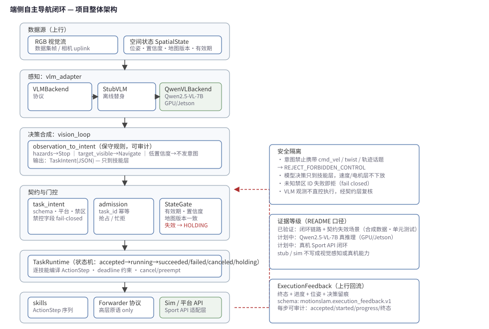

# Autonomous-Navigation-for-Legged-Robots

面向四足机器人端侧导航运行时，提供从视觉语义观测、任务意图准入、技能编排到执行反馈的离线闭环。核心采用 C++20（不依赖 ROS），另有 Python 对照实现；工程分级 **P0**。

## 演示

**演示口径：数据集回放 + Stub 语义观测 + 仿真执行，非真机导航。** RGB 帧及位姿来自 ARKitScenes；视频中的语义观测和动态障碍为演示输入，不代表真实 VLM 感知结果。

<video src="https://github.com/zxinyu-robot/Autonomous-Navigation-for-Legged-Robots/raw/main/docs/media/demo_arkitscenes.mp4" width="720"></video>

（若内嵌不渲染：[直接打开视频文件](docs/media/demo_arkitscenes.mp4)）

巡检路线：数据集位姿轨迹（ARKitScenes 40753679）逐帧驱动——进入目标区（x>1.4m）→Navigate、动态障碍→Stop、其余不发意图；右侧显示窗口、压缩记忆及位姿去重统计。视频中的 KV 复用率是窗口计数推导值，并非实际模型 KV Cache 复用实测。

仓内 `VisionLoop` 提交意图时未传入空间状态，不能据此认定该路径经过了状态门控。下文记录的真实 VLM 推理来自另一次数据集回放，并非本视频的 Stub 推理结果。

## 功能与状态

| 功能 | 当前仓库状态 |
|---|---|
| 任务运行时 | 契约校验、准入、可选空间状态门控、技能编译、仿真执行及反馈；C++20 核心与 Python 对照实现 |
| 视觉编排 | 支持 Stub 观测和 Python Qwen 后端；按置信度、危险标签和目标可见性生成技能意图 |
| 空间与上下文 | 状态快照、增量更新和有效期过滤；视觉观测滑动窗口、位姿去重及历史摘要统计 |
| 数据链路 | 通道、QoS 元数据和进程内 pub/sub；Python Cyclone DDS 后端的 Topic/Reader 注册需部署侧完成 |
| 平台执行 | 提供 `Forwarder` 接口和 `SimForwarder`；Unitree Sport API 适配由部署侧实现 |

## 整体架构



视觉输入经 `VLMBackend` 生成语义观测，`VisionLoop` 合成任务意图；`TaskRuntime` 完成契约和准入检查、可选状态门控，并将技能转换为高层动作交给 `Forwarder`，最后记录执行反馈。图中状态门控为运行时能力，当前视觉路径没有传入状态；数据链路接口也需要由集成方接入。时序参考：[sequence.svg](docs/media/sequence.svg)。

## 快速开始

### 构建与测试

C++ 核心（权威实现）：

```bash
cmake --preset test
cmake --build build/test -j
ctest --test-dir build/test --output-on-failure
```

Python 对照实现（Python ≥ 3.10，无运行时依赖；深度门控为纯 Python 实现）：

```bash
pip install -e ".[dev]"
pytest -q
ruff check src tests
```

### 最小闭环：仿真执行器 + 直接意图

```python
import time
from legged_nav import SimForwarder, SpatialState, TaskRuntime

fwd = SimForwarder(initial_state=SpatialState(map_id="map_01", revision=3, valid=True))
rt = TaskRuntime(fwd, local_platform="unitree_go2_edu", local_robot_id="go2_001")

intent = {
    "schema": "motionslam.task_intent.v1",
    "task_id": "task-001",
    "robot": {"platform": "unitree_go2_edu", "sn": "go2_001"},
    "world_ref": {"map_id": "map_01", "revision": 3},
    "skills": [{"name": "Navigate", "goal": {"x": 2.0, "y": 0.5, "z": 0.35}},
               {"name": "ReturnHome"}],
    "policy": {"deadline_s": 120.0},
}
state = SpatialState(map_id="map_01", revision=3,
                     localization_confidence=0.9, valid=True,
                     timestamp_ns=time.time_ns())
fb = rt.submit(intent, state=state)
print(fb["event"])   # succeeded
```

### 视觉驱动闭环：RGB 帧流 + VLM 后端

```python
from legged_nav import (
    SimForwarder, SpatialState, StubVLMBackend,
    TaskRuntime, VisionContext, VisionLoop,
)

fwd = SimForwarder(initial_state=SpatialState(map_id="map_01", revision=3, valid=True))
rt = TaskRuntime(fwd, local_platform="unitree_go2_edu", local_robot_id="go2_001")

ctx = VisionContext(
    task_prompt="导航到厨房门口",
    robot={"platform": "unitree_go2_edu", "sn": "go2_001"},
    world_ref={"map_id": "map_01", "revision": 3},
    goal={"x": 2.0, "y": 0.5, "z": 0.35},
    deadline_s=120.0,
    min_confidence=0.6,
)

# 离线链路验证：stub 后端
loop = VisionLoop(StubVLMBackend(preset={
    "scene_class": "kitchen", "confidence": 0.9,
    "target_visible": True, "landmarks": ["door_03"],
}), rt, ctx)
decs = loop.run(iter(["frame-0.jpg", "frame-1.jpg"]))
print(decs[0].feedback["event"])  # succeeded

# 真推理后端（需另行安装 transformers、torch、Pillow 并配置模型和算力）：
# from legged_nav.vlm_adapter import QwenVLBackend
# loop = VisionLoop(QwenVLBackend("Qwen/Qwen2.5-VL-7B-Instruct"), rt, ctx)
```

语义决策规则：置信度不足时不发意图；置信度达标且含 `hazards` 时生成 `Stop`；目标可见且配置了目标坐标时生成 `Navigate`；其余不发意图。此示例未向运行时传入空间状态。

## 数据链路

`legged_nav.transport.CHANNELS` 定义传感器、空间状态、模型推理、运动控制和反馈通道：

| 通道 | QoS | schema | 数据 |
|---|---|---|---|
| `rgb/frame` | best_effort | sensor.rgb_frame.v1 | RGB 视觉流上行 |
| `sensor/lidar_scan` `sensor/imu` | best_effort | sensor.scan.v1 / sensor.imu.v1 | 多源传感 |
| `spatial/state` | best_effort | spatial.state.v1 | 位姿·置信度·地图版本 |
| `perception/semantic_obs` | reliable | perception.semantic_observation.v1 | VLM 语义观测 |
| `task/intent` | reliable | motionslam.task_intent.v1 | 技能级决策下行 |
| `motion/action_step` | reliable | motion.action_step.v1 | 高层运动原语（禁含 cmd_vel） |
| `exec/feedback` | reliable | motionslam.execution_feedback.v1 | 执行反馈回流 |

`InProcessTransport` 提供同步分发和留痕。Python `CycloneDDSTransport` 懒加载 Cyclone DDS 绑定，但仓内尚未实现 Topic/Reader 注册；C++ 侧提供传输接口和进程内后端。SHM 与 DDSI-RTPS/UDP 的部署取决于部署侧实现和配置，跨机部署不属于本仓范围。仓内发布接口对 payload 扫描禁控字段；表中 QoS 是通道元数据，不等于进程内后端提供 DDS QoS 保证。

## 空间状态与流式上下文

```python
from legged_nav import SpatialState, SpatialStateStore, StreamContext, VisionToken

store = SpatialStateStore()
state = SpatialState(map_id="map_01", revision=3, valid=True)
store.update("pose", state, ttl_ns=500_000_000)   # 增量写 + 版本自增
live = store.entries()                             # 只返回有效未过期条目

sc = StreamContext(window=8, dedup_dist_m=0.3)    # Fast-Slow Context
sc.push(VisionToken(frame_id="f0", summary="kitchen,door_03", pose=(0.0, 0.0, 0.0)))
print(sc.stats())  # fast_len / kv_cached / dedup_dropped / slow_compressed / kv_reuse_ratio
```

`VisionLoop` 构造时传入 `stream=sc`，每步传入 `pose`，即可记录观测、按位姿去重并压缩窗口历史。仓内 `kv_reuse_ratio` 根据入窗总数和当前窗口长度计算；观测先于入窗产生，该统计不直接证明实际模型 KV Cache 复用或推理开销下降。

## 契约与安全边界

- 意图 schema：`motionslam.task_intent.v1`（字段集与 quadruped-crossfloor-nav-ws 一致）。
- **契约单一来源**：schema、平台/技能白名单、禁控字段、技能种类与超时定义在 `contracts/runtime_contract.json`；
  `scripts/gen_contract.py` 生成 `include/legged_nav/contract_gen.hpp` 与 `src/legged_nav/contract_gen.py`，
  两套实现只消费生成物，CI 用 `--check` 拦截漂移。
- **双实现对照**：C++ 与 Python 读取同一份 `tests/contract_cases.json`（44 条边界用例）逐一比对判定结果，
  Python 侧归一化/类型语义与 C++ 权威实现对齐（字符串去 ASCII 首尾空白，数值只接受 JSON number）。
- 禁控字段：`cmd_vel`/`twist`/轨迹话题名出现在意图任意层级 → `REJECT_FORBIDDEN_CONTROL`，模型决策只到技能层。
- 禁区：`navigation.forbidden_areas` 从本地多边形配置解析；未知 ID 拒绝，Navigate 目标落入禁区即拒。当前只检查目标点，不约束路径穿越。
- 状态门控：提交时传入 `SpatialState` 才会检查有效性、有效期、置信度及地图版本；失效返回 `HOLDING + SAFETY_INTERLOCK`。当前 `VisionLoop` 不传入状态。
- 准入：活动任务的同一 `task_id` 幂等；已受理过的 ID 在有界历史内拒绝重复。忙态时仅允许更高优先级的任务抢占可抢占任务。

## 验证与部署边界

- **合成数据与单元测试**：覆盖契约、门控、运行时、进程内传输及 Stub 视觉链路；CI 配置见 [ci.yml](.github/workflows/ci.yml)。
- **数据集回放**：[证据表](docs/evidence.md) 记录了 RTX 4090 上 Qwen2.5-VL-7B-Instruct-AWQ + vLLM 对 ARKitScenes 和 Elevator-LIO 的回放结果，执行端为 `SimForwarder`，不代表真机导航成功率。脚本使用环境专属的数据和权重路径，复现前需调整；权重配置见 [model_weights.md](docs/model_weights.md)。
- **部署侧**：真机执行需对接 Unitree Sport API；Jetson 推理、DDS Topic 注册及实际传输方式需在部署环境中配置并核验。部署侧结果与本仓仿真证据分别记录。
- **关联仓库证据**：[quadruped-crossfloor-nav-ws](https://github.com/zxinyu-robot/quadruped-crossfloor-nav-ws) 和 [legged-navigation-runtime](https://github.com/zxinyu-robot/legged-navigation-runtime) 的验证以各自说明为准，不等同于本仓增量代码的真机验证。

## 目录

- `include/legged_nav/`、`src/*.cpp`：C++ 核心接口与实现。
- `src/legged_nav/`：Python 对照实现。
- `tests/`：C++ 综合测试及 Python 单元、端到端测试。
- `scripts/`：ARKitScenes 和 Elevator-LIO 数据集回放脚本。
- `contracts/`：运行时契约唯一来源（JSON）及生成物来源。
- `docs/`：证据表、模型权重配置及演示素材。

## 自研与开源集成

- **自研**：本仓运行时及演示模块。
- **参考实现**：契约字段集参考姊妹仓 [quadruped-crossfloor-nav-ws](https://github.com/zxinyu-robot/quadruped-crossfloor-nav-ws)，本仓为端侧独立实现。
- 核心包未声明运行时依赖；测试、视觉推理和数据集回放需要额外依赖，见 [THIRD_PARTY.md](THIRD_PARTY.md) 与相应脚本。

## 关联仓库

- [quadruped-crossfloor-nav-ws](https://github.com/zxinyu-robot/quadruped-crossfloor-nav-ws)：参考实现来源，非子模块。
- [fork-spatial-runtime](https://github.com/zxinyu-robot/fork-spatial-runtime)：空间状态底座。
