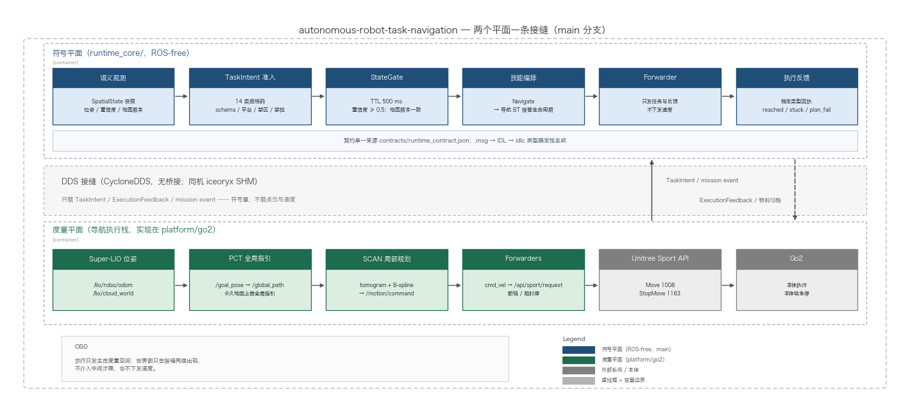

# Fork Navigation Runtime

[](LICENSE)

面向弱网 / 断网环境下自主机器人任务导航的可靠运行时系统。

## 架构


> 图源 `docs/media/qcn_arch.png`。颜色即验收级别：**绿**＝真机主链在运行、**蓝**＝主链 launch 里默认关闭、**橙**＝只在测试/实验中运行、**灰**＝云端两层（文档记录已闭环）、**红虚线**＝设计意图、代码里没有。带 `src/` 前缀的节点实体在 `platform/go2`。



> 接缝只载 TaskIntent / ExecutionFeedback / mission event：蓝＝符号平面（`runtime_core/`，ROS-free），绿＝度量平面（导航栈，实现在 `platform/go2`），灰＝外部 / 本体。

执行只发生在度量空间（OS0）；三空间定义见 [端侧系统架构](docs/架构/架构_端侧系统架构.md)。

### 两层调度

| | `runtime_core`（符号平面） | 导航 BT（度量平面） |
|---|---|---|
| 管什么 | 任务级：准入、优先级、抢占、跨技能失败策略 | 技能级：子目标推进、到达判定、技能内恢复 |
| 一次决策 | 一个任务（可含多个技能） | 技能内一次重试或换路 |
| 状态来源 | `SpatialState` 快照（位姿、置信度、地图版本） | LIO 位姿、局部代价图、规划结果 |
| 失败上报 | `ExecutionFeedback` → 世界侧 | 稳定类型 → `runtime_core` |

PCT / SCAN 是技能内部的度量算子，不是 BT 的下游节点。

## 一条完整链路：跨楼层任务从进来到反馈回去

以「从一楼去二楼会议室门口」为例：

| # | 发生什么 | 执行者 | 被拦下时 |
|---|---|---|---|
| 1 | 产出任务意图：目标点、楼层、`map_id`、`revision` | 世界空间 | 不产生意图就什么都不发生 |
| 2 | `TaskIntent` 过 DDS 接缝（只载符号量） | 接缝 | — |
| 3 | 契约校验：14 类拒绝码（schema / 平台 / 禁区 / 禁控字段 / 参数） | `runtime_core` `admission` | `REJECT_*`，不进执行 |
| 4 | 准入仲裁：task_id 幂等、重复受理、忙态、优先级抢占 | `runtime_core` `TaskAdmission` | `IDEMPOTENT` / `REJECT_DUPLICATE_TASK_ID` / `REJECT_BUSY` / `PREEMPT` |
| 5 | 状态门控：定位有效性、TTL 500 ms、置信度 ≥ 0.5、地图版本一致 | `runtime_core` `StateGate` | 进 `HOLDING`，**不拿过期定位继续走** |
| 6 | 技能编排：`Navigate` → 导航 BT 接管该技能生命周期 | `runtime_core` → BT | `failed(reason)` 上行 |
| 7 | PCT 给全局指引 + SCAN 做局部连续规划（技能内度量算子） | 度量平面 | BT 重决策，换指引而非重试同一点 |
| 8 | 速度与控制下发 | Forwarders → Sport API → Go2 | 本体现急停 |
| 9 | 逐点到达判定 → 技能结果 | BT | 稳定类型 `reached`/`stuck`/`plan_fail`/`link_lost` |
| 10 | `ExecutionFeedback` 回执 + 带 `session`/`context_generation` 的物料归档 | 接缝 | — |

> 第 7–9 步在 [`platform/go2`](https://github.com/zxinyu-robot/autonomous-robot-task-navigation/tree/platform/go2)；当前真机链路还不经过第 3–5 步的运行时裁决。

## 测试报告

**符号平面**（`runtime_core/`，无需 ROS）

| 项 | 结果 | 证据 |
| --- | --- | --- |
| C++ 测试 | `ctest` **2/2**（开 `-DLEGGED_NAV_BUILD_DDS=ON`；默认 OFF 时 1/1） | `runtime_core/tests/` |
| Python 测试 | `pytest` **91** 项 | `runtime_core/tests/` |
| 契约一致性 | 契约与 DDS 类型生成物 `in sync`（5 msg） | `gen_contract.py --check`、`gen_dds_types.py --check` |

**接缝**

| 项 | 结果 | 证据 |
| --- | --- | --- |
| 双向互通（原生 ↔ ROS） | **4/4 通过**，envelope / probe × 双向，字段逐项断言 | `runtime_core/scripts/dds_interop_check.py` |
| QoS 兼容性矩阵 | **7/7** 符合 DDS requested/offered | `runtime_core/scripts/dds_qos_matrix.sh` |
| SHM 实际生效 | 131 MB 载荷：SHM 关 lo 上 UDP 273.6 MB → SHM 开 **4.2 KB** | `runtime_core/scripts/dds_shm_proof.sh` |
| 长稳 64 KiB @ 10 Hz × 20 min × 4 轮 | 零丢失（11960/11960），p50 **1108–1134 µs**，p95 2026–2064 µs | `runtime_core/scripts/dds_soak_repeat.sh` |
| 接收退出语义 T4（100+1s+100）× 5 | 5/5 无提前退出，`idle=2000 ms` | `runtime_core/scripts/dds_sub_exit_cases.sh` |

**度量平面**：云端多楼层闭环 11/11、真机在线建图与规划 —— [云端闭环视频](https://github.com/zxinyu-robot/autonomous-robot-task-navigation/blob/platform/go2/docs/media/cross_floor_demo.mp4)、[真机在线 + Elevator-LIO 回放](https://github.com/zxinyu-robot/autonomous-robot-task-navigation/blob/platform/go2/docs/media/cross_floor_with_elevator_lio.mp4)。

未验证：Humble 容器内复跑上述接缝数字、arm64 / Jetson 实机、≥2 小时长稳、writer-only / reader-only 深度拆分；运行时接入真机主链**计划中**。时序与踩坑记录见 [dds-interop.md](runtime_core/docs/dds-interop.md)（含 Match Gate：`matched < 1` 判 `INVALID`，不出数）。

## 快速开始（无需 ROS、无需 Docker）

```bash
git clone https://github.com/zxinyu-robot/autonomous-robot-task-navigation.git
cd autonomous-robot-task-navigation

# runtime_core
python3 runtime_core/scripts/gen_contract.py --check
python3 runtime_core/scripts/gen_dds_types.py --check
cmake -S runtime_core -B build/runtime_core && cmake --build build/runtime_core -j
ctest --test-dir build/runtime_core --output-on-failure
(cd runtime_core && pip install -e ".[dev]" && pytest -q)

# task_runtime（含 LNR 恢复桥 + 仓内 fork_spatial 契约桥）
cmake -S runtime/task_runtime -B build/task_runtime -DMOTIONSLAM_WITH_LNR=ON -DMOTIONSLAM_WITH_FSR=ON
cmake --build build/task_runtime -j && ctest --test-dir build/task_runtime --output-on-failure

# fork_spatial
cmake -S fork_spatial -B build/fork_spatial && cmake --build build/fork_spatial -j
ctest --test-dir build/fork_spatial --output-on-failure && ./build/fork_spatial/examples/cpp/runtime_demo
```

编译 `runtime_core/dds/` 原生类型支持（需 `find_package(CycloneDDS)` 找到 `libddsc`）：加 `-DLEGGED_NAV_BUILD_DDS=ON`。Go2 真机构建与起栈见 [`platform/go2` README](https://github.com/zxinyu-robot/autonomous-robot-task-navigation/blob/platform/go2/README.md)。

## 署名与许可

主导与系统设计：zxinyu（zxiangsheng2314@gmail.com）。`runtime_core/`（PR #19）、`fork_spatial/`（PR #21）以 `git subtree --squash` 并入，来源见 [THIRD_PARTY.md](THIRD_PARTY.md)，跨仓契约以 [`fork_spatial/docs/contracts/`](fork_spatial/docs/contracts) 为准。工程化与实验脚本在 GitHub Copilot 辅助下完成，未经复现的数字不写入文档。

自研代码 [MIT](LICENSE)；依赖、补丁与第三方代码按各自来源授权，见 [THIRD_PARTY.md](THIRD_PARTY.md)。
